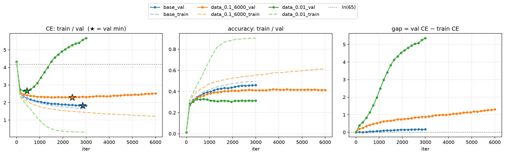
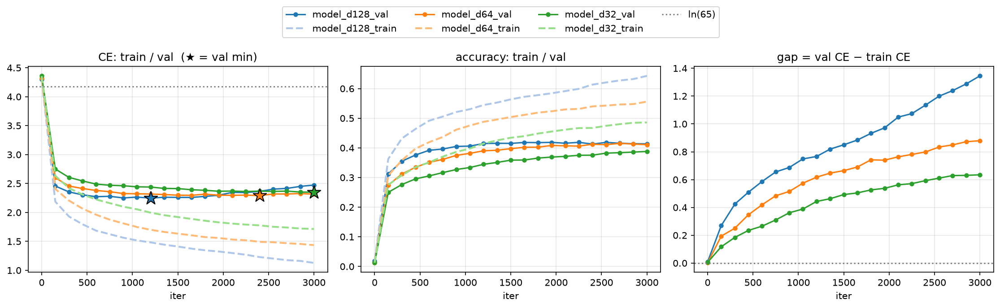
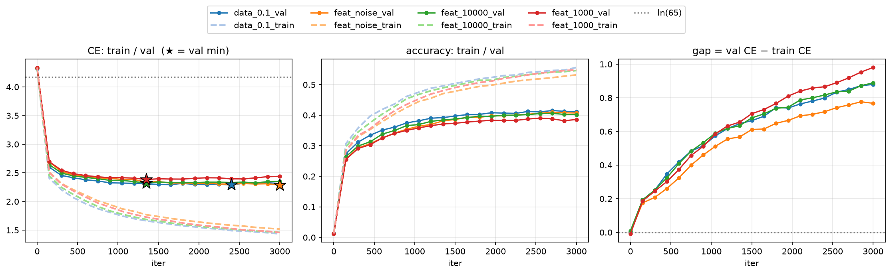
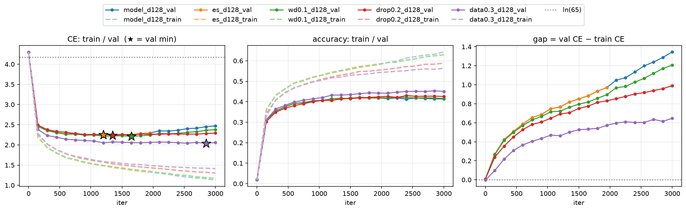
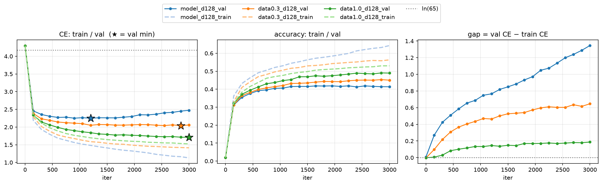

## はじめに

Transformer0-1 の5週目は、過学習を扱った。目標は「過学習の原因と診断の流れを、自分の数字を根拠に説明できるようになる」ことである。

進め方は3段階にした。

1. 原因の違う過学習を、わざと起こす
2. 対策を1つずつ入れて、効き方を比べる
3. 条件を伏せた学習曲線を見て、何が起きているかを当てる

モデルは W2 で作った文字レベルの小さな GPT(GPTMini)、データは tiny_shakespeare(文字の種類 65)である。リポジトリは https://github.com/miyamoto-gt/Transformer0-1 にある。

## 実験の設定

### 共通の設定

| 項目 | 値 |
|---|---|
| block_size / batch_size | 32 / 32(1 iter で 1,024 文字を見る) |
| d_model / 層数 | 64 / 4(実験によって変える) |
| 学習率 | 1e-3(AdamW) |
| weight_decay | 0(既定値の 0.01 を明示的に外した) |
| 学習 | 3000 iter、150 iter ごとに評価 |

### 物差しを先にそろえた

対策を比べる前に、評価の方法を固定した。ここをそろえないと、対策の効果と測り方の違いが混ざる。

- **train と val を同じ方法で測る**:学習ループの loss(1バッチ)は ±0.1 程度ぶれるので使わない。train も val も、eval mode で、固定した 50 バッチの平均を取る。train は「実際に学習に使ったデータ」で測る
- **評価の乱数を学習から切り離す**:評価バッチは専用の `torch.Generator` で最初に1回だけ作る。これで、評価の間隔を変えても学習の軌跡が変わらなくなった(150 刻みと 300 刻みで、共通の iter の数値が完全に一致した)
- **主の物差しは val CE、正解率は副**:CE は「正解にどれだけ確率をつけたか」まで見るので、正解率より先に悪化が表れる

### 過学習の判定基準

基準の実験(全データ)では、過学習していないのに val が1点だけ上がることがあった(+0.002〜0.004)。そこで、次の2つを同時に満たしたときだけ「過学習」と判定した。

- val CE の最小値を **5回続けて**更新しない
- 現在の val CE が最小値より **0.02 以上**高い(ノイズ 0.004 の5倍)

回数の条件は「1点だけの上下で判定しない」ため、量の条件は「誤差の範囲の悪化で判定しない」ためにある。**gap(val CE − train CE)が開くことは判定に使わない。** 基準の実験では gap が 0.17 まで開いたが、val は最後まで下がり続けていた。

## 1. 過学習をわざと起こす

土台は「学習データ 10%(100,385 文字)・3000 iter・d_model 64」の `data_0.1` にした。この設定は、3000 iter の時点で判定まであと1点(4回)という「ぎりぎり過学習しない」状態である。ここから1つだけ変えて、過学習に転ぶかを見た。

| 原因 | 変えたもの | val の最小値 | 判定 |
|---|---|---|---|
| 訓練データが少ない | データ 10% → 1% | 2.66 / iter 450 | iter 1200 |
| 学習回数が多すぎる | 3000 → 6000 iter | 2.29 / iter 2400 | iter 3150 |
| モデルが大きすぎる | d_model 64 → 128 | 2.25 / iter 1200 | iter 1950 |
| 不要な特徴がある | 入力に「区間ID」を追加 | 2.38 / iter 1350 | iter 2100 |

### データが少ない

- **変えたこと**:学習データを 100% → 10% → 1% に減らした
- **結果**:1% では iter 450 で底(2.66)を打ち、iter 1500 で val CE が 4.33 になって ln(65) = 4.17 を超えた。最終は 5.66。train の正解率は 0.905 まで上がったが、val の正解率は 0.31 前後で横ばいだった
- **考察**:ln(65) は「65文字に均等に確率をつける」予想の CE である。それを超えたということは、でたらめに当てるより悪い。train で丸暗記した並びを、val にも自信満々に当てはめている

予想していた「1エポックを過ぎたら悪化する」は外れた。実際には、10% で約24エポック、1% で約46エポックまで val は改善した。よく出る規則(空白の位置、よく出る単語、話者名と改行の形)を学び尽くしてから、特定の並びの丸暗記が始まるのだと考える。

### モデルが大きすぎる

- **変えたこと**:d_model を 32 / 64 / 128 にした(データ 10%)
- **結果**

| d_model | パラメータ | val の最小値 | 最終 val | 最終 gap |
|---|---|---|---|---|
| 128 | 約82万 | **2.25** / 1200 | 2.47 | 1.35 |
| 64 | 約22万 | 2.29 / 2400 | **2.32** | 0.88 |
| 32 | 約6万 | 2.35 / 3000 | 2.35 | 0.63 |

- **考察**:大きいモデルほど、底は低く早く来るが、そのあとの悪化も速い。最小値で比べると d128 が勝ち、最終値で比べると d64 が勝つ。d32 は過学習しなかったが、最小値でも最終値でも d64 に負けた。縮めすぎると、丸暗記する力と一緒に規則を学ぶ力も失う(未学習)

### 不要な特徴がある

各サンプルに「学習テキストのどのあたりから切り出したか」の番号(区間ID = 開始位置 ÷ 1,000)を付け、その埋め込みを入力に足した。次の文字の予測には本来関係のない情報である。

| | train の区間ID | val の最小値 | 判定 | 最終 gap |
|---|---|---|---|---|
| なし | ― | **2.29** | 届かない | 0.88 |
| ランダム | 毎回ランダム | **2.29** | 届かない | 0.77 |
| 位置から(12区間) | 開始位置 ÷ 10,000 | 2.32 | iter 2850 | 0.89 |
| 位置から(112区間) | 開始位置 ÷ 1,000 | 2.38 | iter 2100 | 0.98 |

- **変えたこと**:区間IDを位置から付ける/ランダムに付ける、を比べた
- **結果**:位置から付けると過学習に転び、区間を細かくするほど悪化した。同じ大きさのベクトルをランダムに付けると、悪化は起きなかった
- **考察**:悪化の原因は「ベクトルを足したこと」ではなく、「train でだけ通用する手がかりに頼れたこと」である。train では区間23に特定の場面が集まるので「区間23ならこの名前」と覚えられるが、val の区間23は別の場面なので外れる。ランダムでは区間IDと内容の関係を覚えられないので、勾配が打ち消し合い、手がかりとして育たない

予想していた「区間IDで train が楽になり、train CE が速く下がる」は外れた。train CE はむしろわずかに遅く、悪化は val の側で起きた。

**不要な特徴が有害なのは、存在するからではなく、モデルが train でそれに頼れてしまうからである。**

実装では、区間IDの埋め込みの初期化で乱数を余分に使い、学習バッチの並びがずれる問題があった。`torch.random.fork_rng()` で初期化を囲み、モデルを作ったあとの乱数が元のモデルと一致することを確かめてから比べた。

## 2. 対策を比べる

対象は、過学習がはっきり出た「d_model 128・データ 10%」にした。対策は1つずつ入れる。

| 対策 | val の最小値 | 判定 | 最終 val | 最終 gap |
|---|---|---|---|---|
| なし | 2.2484 / 1200 | 1950 | 2.4737 | 1.35 |
| 早期終了(patience 5) | 2.2484(取り出す) | 1950 で停止 | ― | ― |
| weight decay 0.1 | **2.2136** / 1650 | 2400 | 2.3790 | 1.21 |
| Dropout 0.1 | 2.2364 / 1350 | 2100 | 2.3569 | 1.13 |
| Dropout 0.2 | 2.2378 / 1350 | 2100 | 2.2934 | 0.99 |
| データ 30% | **2.0371** / 2850 | 届かない | **2.0600** | **0.65** |

### 早期終了

- **結果**:iter 1950 で止まり、残したモデルを測り直すと val CE 2.2484(iter 1200 の値と一致)。学習は 3000 → 1950 iter に減った
- **考察**:早期終了は最小値を下げない。最小値の時点を取り出す対策である。止まるのは底(1200)ではなく、5回の不更新を確かめた 1950 で、その差 750 iter(patience × 評価間隔)が待ち時間になる。だから、最小値を更新したときにモデルを保存しておく必要がある

### weight decay

- **結果**:最小値が 2.2484 → 2.2136 に下がり、判定は 1950 → 2400 に遅れた。iter 150 の値は weight decay なしとほぼ同じ(2.4564 / 2.4567)だった
- **考察**:weight decay は毎ステップ、重みをその大きさに比例して 0 に引き戻す。丸暗記に必要な大きな重みを作りにくくなるので、最小値そのものが下がった。1ステップの引き戻しは 1e-3 × 0.1 = 0.01% と小さく、効果は後半に積み重なって表れる。既定値の 0.01 では 3000 ステップで約3% しか縮まず、ほとんど効かなかった

### Dropout

埋め込みの直後に1か所だけ `nn.Dropout` を入れた。`m.train()` では同じ入力でも毎回出力が変わり、`m.eval()` では変わらないことを `torch.equal` で確かめた。

- **結果**:最小値はほぼ変わらなかった(2.2484 → 2.2364 / 2.2378)。最小値から最終までの悪化は、+0.225 → +0.121(p = 0.1)→ +0.056(p = 0.2)と小さくなった
- **考察**:Dropout は良い時点をより良くするのではなく、良い時点を長持ちさせた。p を上げるほど train は遅くなったが(最終 1.13 → 1.23 → 1.30)、val の正解率は下がらなかった。train で失った分は、もともと val に持ち越せない丸暗記の分だったと考える

Dropout は学習中に乱数を使うので、学習バッチの並びも変わる。最小値の 0.01 程度の差には、その影響も含まれる。

### モデルを縮める

前の節の d_model 64 / 32 の結果がこれにあたる。過学習は消えたが、最小値は上がった。過学習と未学習のトレードオフである。

### データ増量

| データ | エポック数 | val の最小値 | 判定 | 最終 gap |
|---|---|---|---|---|
| 10% | 約31 | 2.25 | iter 1950 | 1.35 |
| 30% | 約10 | 2.04 | 届かない(横ばい) | 0.65 |
| 100% | 約3 | **1.71** | 届かない(改善中) | **0.19** |

- **結果**:最小値の改善は、weight decay が 0.035、データ3倍が 0.21、データ10倍が 0.54 だった。val の正解率が目に見えて上がったのも、データ増量だけである
- **考察**:同じモデルでも、データ量によって「過学習・横ばい・改善中」が分かれた。過学習するかどうかは、モデルの大きさだけでなく、モデルの大きさとデータ量の釣り合いで決まる。全データでは d_model 128(1.71)が d_model 64(1.83)に勝ったので、データが十分あれば大きいモデルの方が良い

### 対策のまとめ

| 対策 | 何をするか | 最小値 | 過学習 |
|---|---|---|---|
| 早期終了 | 良い時点を取り出す | 変えない | 止めるだけ |
| weight decay | 大きな重みを作りにくくする | 下げる | 遅らせる |
| Dropout | 学習中にノイズを入れる | ほぼ変えない | 悪化を緩やかにする |
| モデルを縮める | 丸暗記する力を減らす | 上げる(縮めすぎると未学習) | 消える |
| データ増量 | 学べる規則を増やす | **大きく下げる** | 消える |

weight decay・Dropout・モデルを縮めるは、どれも「丸暗記する力を弱める」対策で、強すぎると学ぶ力まで弱める。val の性能そのものを大きく上げたのは、データ増量だけだった。

## 3. 診断の流れ

最後に、条件を伏せた学習曲線を3つ見て、何が起きているかを当てた。

| 状況 | 診断 | 対策 |
|---|---|---|
| 底が高く早い(2.62 / iter 300)、train が 0.25、val が ln(65) を超える | データ不足の過学習 | 早期終了 → データ増量 |
| gap 0.05 のまま、train も val も高止まり | 未学習(モデルが小さい) | モデルを大きくする・正則化を弱める |
| gap は開くが val は下がり続け、最後に1点だけ +0.002 | 順調 | 止めずに学習を延ばす |

ここから、診断の流れを次のようにまとめた。

1. まず val CE の最小値と、そのあとの動きを見る。最終値だけでは判断しない
2. 過学習は「最小値を5回続けて更新せず、かつ最小値より 0.02 以上悪化した」ときに判定する。gap が開くだけでは過学習と言わない
3. 過学習なら、底の高さと位置で原因を見分ける。底が高く早く、train が丸暗記の水準まで下がるならデータ不足。底は低いがその後上がるならモデルが大きすぎる
4. 過学習なら丸暗記を抑える対策、未学習なら逆に学ぶ力を増やす対策を選ぶ。同じ対策の一覧でも、診断によって選ぶ向きが正反対になる
5. 曲線がずっと下がっていることが成功とは限らない。どちらの場合も早期終了を入れ、val が最小になった時点のモデルを残す

## 大きなモデルの学習との関係

今回のモデルは最大でも約82万パラメータと小さく、数字はそのまま大きなモデルには当てはまらない。ただ、考え方と流れは使えると考える。

**モデルとデータの釣り合い**
d_model 128 はデータ 10% では d64 に負け、全データでは勝った。モデルの大きさとデータ量の釣り合いを大規模に調べたのがスケーリング則で、損失はパラメータ数・データ量・計算量に対してべき乗則で下がり[^kaplan]、同じ計算量ならパラメータ1あたり約20トークンのデータが釣り合うと報告されている[^chinchilla]。今回の結果は、その関係の小さな版にあたる。

**学習の段階によって、過学習の重さが違う**

| 段階 | 過学習 | 今回の対策との対応 |
|---|---|---|
| LLM の事前学習 | ほぼ起きない。データが膨大で、多くは1周未満 | weight decay(0.1 前後)は使う。Dropout は使わないことが多い。同じデータを何周も回すと効果が落ちる[^muennighoff] |
| ファインチューニング(SFT・LoRA) | 起きやすい。データが少なく、何エポックも回す | `lora_dropout`、`weight_decay`、評価間隔と best モデルの読み込み(早期終了)が、そのまま設定項目として出てくる |
| Physical AI(模倣学習) | 起きやすい。お手本を集めるのが高い | データ不足の過学習が起きやすい。ただし val loss が低くても、動かすと失敗することがあり、loss だけでは判定できない |

**ショートカット学習**
区間IDの実験は、train でだけ通用する手がかりに頼る「ショートカット学習」の小さな版である。大きなモデルでも、データの作り方次第で同じことが起きる。

**例外もある**
大きなモデルでは、val が一度悪化したあと、学習を続けるとまた良くなる現象(二重降下・grokking)も報告されている。「val の最小値で止める」は基本だが、規模が大きくなると例外がある。

## 効かなかったこと・外れた予想

- 「1エポックを過ぎたら悪化する」:外れた。10% で約24エポック、1% で約46エポックまで改善した
- 「区間IDで train が速く下がる」:外れた。train はむしろ遅く、悪化は val の側で起きた
- 「d_model 32 にすれば底が下がる」:外れた。過学習は消えたが、底は 2.35 と一番高かった(未学習)
- 「Dropout は最小値を下げる」:ほぼ外れた。最小値は約 0.01 しか変わらず、効いたのは最小値のあとの悪化の速さだった
- weight decay の既定値(0.01):ほとんど効かなかった(差 0.004)

## まとめ

- 過学習の判定には val CE の最小値を使い、gap は使わない
- 過学習の原因は、底の高さと位置で見分けられる
- 対策は「最小値を下げる」「時点を取り出す」「悪化を遅らせる」で役割が違う
- 一番効いたのはデータ増量で、過学習するかどうかはモデルの大きさとデータ量の釣り合いで決まる
- 不要な特徴が有害なのは、train でそれに頼れてしまうからである

次の W6 では、トークン化と画像パッチを扱う。

## 参考文献

- SHIFT「過学習とは?機械学習で起きる原因や対策、解決方法について解説」 https://service.shiftinc.jp/column/10751/
- kuroitu「Dropout の実装」Qiita https://qiita.com/kuroitu/items/d1bed8c216950d87be74 (仕組みの確認に使った。マスクの作成に正規分布の乱数を使っている点は、一様分布であるべきと判断した)
- PyTorch `torch.nn.Dropout` https://docs.pytorch.org/docs/2.15/generated/torch.nn.Dropout.html

[^kaplan]: Kaplan et al., "Scaling Laws for Neural Language Models", 2020. https://arxiv.org/abs/2001.08361
[^chinchilla]: Hoffmann et al., "Training Compute-Optimal Large Language Models", 2022. https://arxiv.org/abs/2203.15556
[^muennighoff]: Muennighoff et al., "Scaling Data-Constrained Language Models", 2023. https://arxiv.org/abs/2305.16264