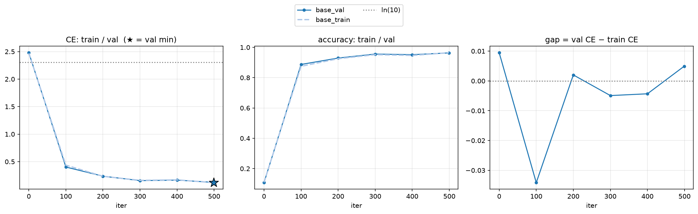

Transformer をゼロから実装する8週間の計画の6週目である。今回は、W2 で作った小さな GPT の胴体(`Block`)を1行も変えずに、**入口だけ**を差し替えた。

- 画像:手書き数字(MNIST)をパッチに切ってトークンにし、数字を当てさせる
- 文字:同じ文を3つのトークナイザで区切り、トークン数と区切り方を比べる

リポジトリ:https://github.com/miyamoto-gt/Transformer0-1

## 入口・胴体・出口

この計画は、胴体を固定したまま入口と出口を付け替えていく作りになっている。

```
W2:  文字ID → 埋め込み表       → [Block × 4] → 次の文字(65クラス)
W6:  画像   → パッチ + Linear  → [Block × 4] → 数字(10クラス)
W7:  状態   → Linear           → [Block × 4] → 動作(連続値)
```

胴体が受け取るのは `(B, T, d_model)` の形だけである。入口でこの形にそろえれば、中身が文字か画像かを胴体は区別しない。W6 はこれを確かめる週である。

## 1. 画像をトークンにする

### 何を変えたか

28×28 の画像を 7×7 のパッチ16個に切り、各パッチ(49画素)を `Linear(49→64)` で64次元のベクトルにした。

```
画像        (B, 1, 28, 28)
 │ 7×7 に切って平らにする
パッチ列    (B, 16, 49)
 │ Linear(49 → 64)
トークン列  (B, 16, 64)   ← W2 の文字トークン列と同じ形
 │ + 位置埋め込み → Block × 4 → LayerNorm
 │ 最後のパッチを取り出す
            (B, 64)
 │ Linear(64 → 10)
ロジット    (B, 10)
```

変えたのは入口(パッチ化)と出口(10クラス)だけで、`Block` は W2 のファイルをそのまま import した。

W2 の `Block` には未来を見ないマスクが入っている。そのため、全パッチを見られるのは最後のパッチだけである。分類には最後のパッチ `x[:, -1]` を使った。

### 前処理:255 で割る

MNIST の画素は 0〜255 の整数で保存されている。これを float にして 255 で割り、0〜1 にそろえた。

文字のときはこの作業が要らなかった。埋め込み表から引いたベクトルの大きさは、初期化で決まるからである。画像は画素の値がそのまま `Linear` に入るので、大きさを自分でそろえる必要がある。

### どうなったか

設定:d_model=64、n_layer=4、batch_size=256、AdamW(lr=1e-3)、パラメータ数 204,170。val には MNIST のテスト用1万枚を使い、train と val それぞれ固定した20バッチで測った。

| iter | train CE | train acc | val CE | val acc |
|---|---|---|---|---|
| 0 | 2.4703 | 11.0% | 2.4797 | 10.7% |
| 100 | 0.4369 | 87.5% | 0.4028 | 88.7% |
| 200 | 0.2344 | 92.5% | 0.2365 | 92.9% |
| 300 | 0.1605 | 95.2% | 0.1556 | 95.6% |
| 400 | 0.1691 | 94.7% | 0.1648 | 95.2% |
| 499 | 0.1187 | 96.5% | 0.1236 | 96.3% |



500ステップで val 正解率 96.3% に達した。train と val の差は ±0.03 以内で、0 の上下を行き来しただけだった。

### なぜそうなったか

**学習前の loss は ln(クラス数) 付近から始まる。** 学習前の val CE は 2.48 で、10クラスを当てずっぽうに選んだときの ln10 ≒ 2.30 に近い。W2 の文字モデルも、ln65 ≒ 4.17 に対して 4.33 だった。どちらも +0.16 ほどずれており、入力の種類によらず同じふるまいだった。

**過学習しなかったのは、見た枚数が少ないからである。** 500ステップ × 256枚 ≒ 12.8万枚で、学習用6万枚を約2周しただけである。W5 で見た「gap が一方向に増え続ける」形にはならなかった。

gap のグラフは縦軸が自動で ±0.03 に合わせられ、大きく揺れて見えた。比べるときは縦軸を固定したほうがよい。

### 予想が外れたところ

学習前に「500ステップで val CE 0.20、正解率 50%」と予想した。CE は近かったが、正解率は大きく外れた。

この組み合わせは、そもそも起こらない。間違えた画像1枚では、正解より大きい確率を付けた別の数字がある。2つの確率の合計は1以下なので、正解に付けた確率は 0.5 以下になり、その1枚の loss は −ln(0.5) ≒ 0.69 以上になる。正解率 50% なら、平均の CE は 0.5 × 0.69 ≒ 0.35 以上である。CE が 0.20 まで下がれば、正解率は必ず 50% よりずっと高くなる。

## 2. 文字をトークンにする

### 何を変えたか

同じ3つの文を、3つのトークナイザで区切った。

| トークナイザ | 方式 | 主な学習データ |
|---|---|---|
| char(W2) | 1文字 = 1トークン | tiny_shakespeare の65文字 |
| tiktoken(`o200k_base`) | byte-level BPE | 英語・コード中心 |
| llm-jp(`llm-jp-3-1.8b`) | Unigram | 日本語を多く含む |
### サンプルのテキスト
- ja(日本語):`吾輩は猫である。名前はまだ無い。`
- en(英語):`To be, or not to be, that is the question.`
- code:`def forward(self, x):\n    return self.proj(x) + x`

### どうなったか

| text | chars | bytes | char(W2) | tiktoken | llm-jp |
|---|---|---|---|---|---|
| ja | 16 | 48 | KeyError | 14 | 10 |
| en | 42 | 42 | 42 | 13 | 13 |
| code | 49 | 49 | KeyError | 15 | 19 |

バイト数 ÷ トークン数で見ると、1トークンに詰め込めた量は次のとおりである。

| text | tiktoken | llm-jp |
|---|---|---|
| ja | 3.4 | 4.8 |
| en | 3.2 | 3.2 |
| code | 3.3 | 2.6 |

日本語は llm-jp、コードは tiktoken のほうが少ないトークンで表せた。英語は同じだった。

区切り方は次のとおりである。

```
[ja] tiktoken(14): '吾' | '�' | '�' | 'は' | '猫' | 'で' | 'ある' | '。' | '名前' | 'は' | 'まだ' | '無' | 'い' | '。'
[ja] llmjp(10):    '▁' | '吾' | '輩' | 'は' | '猫' | 'である。' | '名前' | 'はまだ' | '無い' | '。'
[code] tiktoken(15): 'def' | ' forward' | '(self' | ',' | ' x' | '):\n' | '   ' | ' return' | ...
[code] llmjp(19):    '▁def' | '▁forward' | '(' | 'self' | ',' | '▁x' | '):' | '<0x0A>' | '▁▁▁' | '▁return' | ...
```

区切り方についても、実行前に2つ予想していた。

| 予想 | 結果 |
|---|---|
| llm-jp は「吾輩は猫である」を `吾輩 / は / 猫 / で / ある` で切る | `吾 / 輩 / は / 猫 / である。`。「吾輩」は分かれ、「である」は句点とくっついた |
| tiktoken は `    return` の空白4つを単独のトークンにしない | 空白3つが単独で1トークン、残り1つは `' return'` にくっついた |

### なぜそうなったか

1. **区切りは文法ではなく頻度で決まる。** 
   
   llm-jp の `'はまだ'` は、助詞の「は」と副詞の「まだ」がくっついている。`'である。'` も、文末でよく並ぶので1つになった。逆に「吾輩」は今の文章でめったに出ないので、`吾 / 輩` に分かれた。

2. **だから、学習データで得意な言語が決まる。** 
  
   日本語を多く学習した llm-jp は日本語を、英語とコードを多く学習した tiktoken はコードを、少ないトークンで表せる。

3. **英語は同じだった。** 
   
   llm-jp は日本語に強いが、英語に弱いわけではない。llm-jp-3 は日本語だけでなく英語やコードも含むデータで学習しており、よく使う英単語は語彙に入っている。今回の英文は、どの単語も2つのトークナイザで1トークンになった。13トークン = 単語10個 + 記号3個で、空白をまたいでくっつけない限り、この文ではこれ以上減らせない。簡単な文なので、両方とも下限に達して差がつかなかった。差を見るには、専門用語などのめったに出ない単語を含む文が要る。

4. **語彙にない文字の扱いが、方式で違う。**

  
   - char(W2) は、語彙が tiny_shakespeare に出てきた65文字だけなので、日本語は1文字目で止まった。日本語だけでなく、シェイクスピアに出てこない `(` `)` `+` を含むコードでも止まった
  
   - tiktoken はバイトから出発する BPE なので止まらない。ただし「輩」(UTF-8 で3バイト)は2つの断片に分かれ、どちらも単独では文字に戻せず `'�'` になった
  
   - llm-jp は、語彙にない改行をバイトに分解して `'<0x0A>'` で表した

llm-jp の方式は、`type(tok.backend_tokenizer.model).__name__` で確かめると `Unigram` だった。改行で見えたバイトへの分解(byte fallback)と合わせて、llm-jp-3 が Unigram の byte-fallback トークナイザを使っているという公式の説明と一致する。

## 3. この実験で言えないこと

日本語で llm-jp が少なかった理由が、学習データの違いなのか、アルゴリズム(BPE と Unigram)の違いなのかは、この比較では分けられない。2つが同時に違っているからである。語彙数も違う。

分けるには、語彙数をそろえて自分でトークナイザを学習させ、条件を1つずつ変える必要がある。

| | 英語で学習 | 日本語で学習 |
|---|---|---|
| BPE | A | B |
| Unigram | C | D |

A と B の差が学習データの効果、B と D の差がアルゴリズムの効果になる。

また、今回測ったのはトークナイザの効率であり、モデル自体が日本語やコードをどれだけ上手に扱えるかは測っていない。

## まとめ

- 入口で `(B, T, d_model)` にそろえれば、画像でも W2 の胴体はそのまま学習した(val 正解率 96.3%)
- 画像は画素がそのまま入るので、`/255` で大きさをそろえる前処理が必要だった
- トークナイザには言語ごとの得意・不得意があり、それは学習データでの頻度で決まる
- 文字単位の語彙は学習データの文字だけで決まり、それ以外の文字では止まる

次の W7 では、同じ胴体のまま出口を「動作(連続値)」に差し替える。

## 参考

- [画像データを学習・検証として扱う(Qiita)](https://qiita.com/taiga10969/items/24d85860ffcd724de9eb)
- [トークナイザーの実装(Qiita)](https://qiita.com/keishi_irisa/items/72a02be64d1ec34a706f)
- [Byte Pair Encoding vs. Unigram Tokenization: A Deep Dive into Subword Models(Medium)](https://medium.com/@xiaxiami/byte-pair-encoding-vs-unigram-tokenization-a-deep-dive-into-subword-models-4963246e9a34)
- [openai/tiktoken](https://github.com/openai/tiktoken)
- [llm-jp/llm-jp-3-1.8b](https://huggingface.co/llm-jp/llm-jp-3-1.8b)
- [llm-jp/llm-jp-tokenizer](https://github.com/llm-jp/llm-jp-tokenizer)
- [karpathy/ng-video-lecture](https://github.com/karpathy/ng-video-lecture)